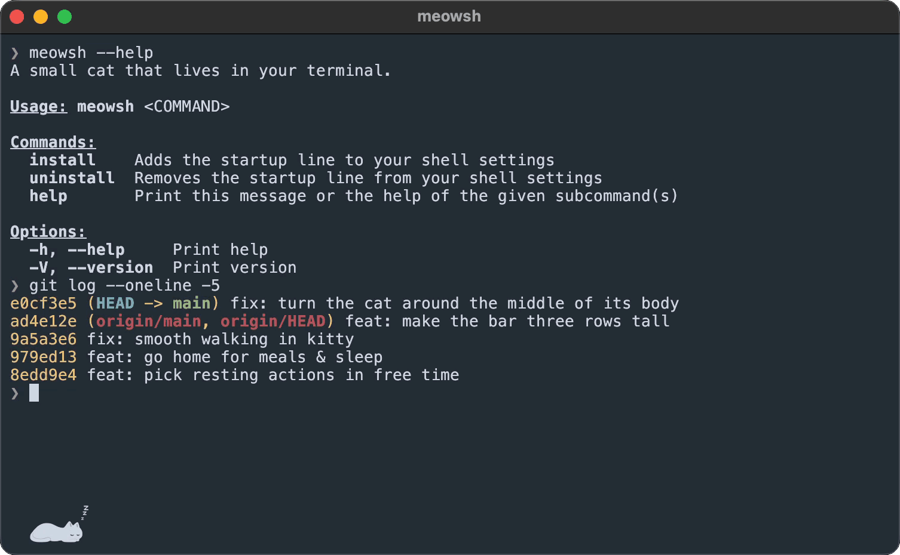

<h1 align="center">meowsh</h1>

<p align="center">A small cat that lives at the bottom of your terminal.</p>

<p align="center">
  <a href="https://crates.io/crates/meowsh"></a>
</p>

<p align="center">
  
</p>

## Requirements

* kitty or VS Code.
* bash or zsh.
* macOS.
* Rust 1.89 or newer.

## Install

```sh
cargo install meowsh
meowsh install
```

## Remove

```sh
meowsh uninstall
cargo uninstall meowsh
```

## License

* Dual licensed under [MIT](LICENSE-MIT) & [Apache 2.0](LICENSE-APACHE).
