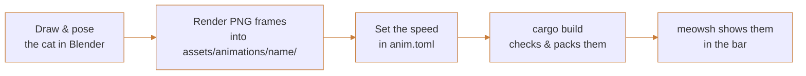

# Animation

* How the cat is drawn in Blender & how its pictures get into Meowsh.
* What the cat does with them: [DESIGN.md](DESIGN.md). How the program loads them: [ARCHITECTURE.md](ARCHITECTURE.md#the-art-part).

## Contents

* [Overview](#overview)
* [Words Used Here](#words-used-here)
* [From Blender To Terminal](#from-blender-to-terminal)
* [Frame Rules](#frame-rules)
* [Folder Layout](#folder-layout)
* [The anim.toml File](#the-animtoml-file)
* [Blender Setup](#blender-setup)
* [Props](#props)
* [Checking An Animation](#checking-an-animation)
* [Animation List](#animation-list)

## Overview

* The cat is drawn & posed in Blender (5.2) with Grease Pencil. It is not made by code.
* Blender saves each animation as numbered PNG pictures.
* Meowsh builds those pictures into the program. The terminal only ever sees PNGs.
* Frame counts are in [ANIMATIONS.md](ANIMATIONS.md). The finished frames are in [FRAMES.md](FRAMES.md).

* **The Blender file is the source.** It is committed next to the pictures, so anyone can open it & fix a frame.
* **Every picture follows the same rules.** Same size, same floor, so Meowsh can draw any frame anywhere without lining it up.
* **Speed lives with the art.** How fast frames play & how far the cat moves are set in `anim.toml`, not in Rust.

## Words Used Here

| Word | Meaning |
| --- | --- |
| **Frame** | One PNG picture. |
| **Animation** | A folder of frames played in order, plus an `anim.toml`. |
| **Canvas** | The size every frame shares, in pixels. |
| **Floor** | The pixel row the cat's feet stand on, the same in every frame. |
| **Turn column** | The pixel column in the middle of the cat's body. The cat turns around it. |
| **Step** | How far the cat moves along the bar each frame, in pixels. |
| **Bones** | Handles added to the drawing in Blender, so the cat can be posed instead of redrawn. |
| **Action** | Blender's name for one animation, such as the walk. |

## From Blender To Terminal



## Frame Rules

* The build checks these & stops if one is broken.

| Rule | Why |
| --- | --- |
| PNG, 8 bit RGBA, with a see through background. | The terminal's own background shows behind the cat. |
| Every frame of every animation is the same size. | Meowsh can swap any frame for any other in place. |
| The feet stand on the same floor in every frame. | The cat does not jump up & down between animations. |
| The cat faces right. | Meowsh flips it to face left. |
| Frames are named `00.png`, `01.png` & so on, with no gaps. | Meowsh plays them in that order. |
| Keep the canvas small. | Every change sends a whole picture. Smaller pictures send faster. |

* The canvas size, floor & turn column are set once in `assets/animations/canvas.toml`:

```toml
width = 309
height = 215
floor = 204
turn_x = 138
```

* `turn_x` is the middle of the cat's body. Meowsh turns the cat around that column, so it turns in place instead of jumping sideways.

* Meowsh scales this to fit the three row bar.

### Color

* Draw the cat in pure white, with black details such as the eyes.
* Meowsh changes white to the terminal's text color & black to its background color. Greys land in between.
* On a dark theme the cat looks the way you drew it. On a light theme it turns dark with light eyes, so it does not vanish.
* If the terminal does not say its colors, the cat keeps the colors you drew.
* A prop that keeps its own colors, such as a red ball, sets `recolor = false` in its `anim.toml`.

## Folder Layout

```
assets/
├── art/
│   ├── sit.blend           the cat posed for one animation
│   ├── walk.blend
│   ├── ...
│   └── props.blend         the bowl & the ball
└── animations/
    ├── canvas.toml         the shared size, floor & turn column
    ├── sit/
    │   ├── anim.toml
    │   ├── 00.png
    │   ├── 01.png
    │   └── ...
    ├── walk/
    └── ...
```

* The folder name is the animation's name in the code, such as `sit` or `walk`.
* Each animation has its own Blender file in `assets/art/`, named like its folder, such as `sit.blend`.

## The anim.toml File

```toml
# how long each frame shows, in milliseconds
frame_ms = 120

# true: play again from the start. false: stop on the last frame.
loop = true

# pixels the cat moves forward each frame. 0 means it stays in place.
step = 0

# true: change white to the terminal's text color.
recolor = true
```

| Setting | Required | Default |
| --- | --- | --- |
| `frame_ms` | Yes | none |
| `loop` | No | `false` |
| `step` | No | `0` |
| `recolor` | No | `true` |
| `frame_ms_each` | No | none. One time per frame, for frames that hold longer, such as a blink. |

* Change a number here & rebuild. No Rust change is needed.

## Blender Setup

* A Grease Pencil drawing of the cat, in white, facing right.
* A camera looking straight at the cat with no perspective (Orthographic), framing exactly 309 by 215 pixels.
* Output: 309 by 215, PNG, RGBA, 8 bit color depth, with a see through background (Render Properties, Film, Transparent).
* A thin guide line on the floor row, so every pose stands on it. Hide it before you render.
* Bones for the body, head, tail & each leg.
* One Blender file per animation, named like its folder: `sit.blend`, `walk.blend` & so on.
* Render each one to `assets/animations/<name>/` as `00.png`, `01.png` & so on.

* Set Blender's frame rate to match `frame_ms`, so the preview in Blender plays at the same speed as Meowsh. For example, 120 ms is about 8 frames per second.

## Props

* Props are things in the bar that are not the cat: the bowl & the ball.
* Each prop is an animation folder too, usually with one frame.
* Props use the same canvas height & floor, so they stand on the same ground as the cat. Their width can differ.

## Checking An Animation

* Render the frames into the folder.
* Run `cargo build`. If a rule is broken, the message names the file.
* Play one animation in the bar on its own:

```sh
cargo run -- preview walk
```

* Watch it in kitty & in the VS Code terminal.
* `preview` is a hidden helper for development.

## Animation List

* The animations the cat needs, from [DESIGN.md](DESIGN.md#the-cats-look). Fill in the status as you go.
* `sit_down` is played backwards to stand up.

| Animation | Loops | Moves | Status |
| --- | --- | --- | --- |
| `sleep` | Yes | No | Drawn |
| `wake` | No | No | To draw |
| `sit` | Yes | No | Drawn |
| `sit_down` | No | No | To draw |
| `walk` | Yes | Yes | Drawn |
| `run` | Yes | Yes | To draw |
| `turn` | No | No | To draw |
| `eat` | Yes | No | To draw |
| `crouch`, `pounce`, `bat` | No | `pounce` | To draw |
| `look_up` | No | No | To draw |
| `flinch` | No | No | To draw |
| `perk_up` | No | No | To draw |
| `purr` | Yes | No | To draw |
| `bowl` | Prop | No | To draw |
| `ball` | Prop | Rolls | To draw |
