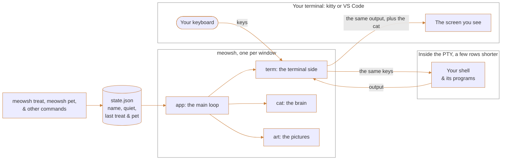
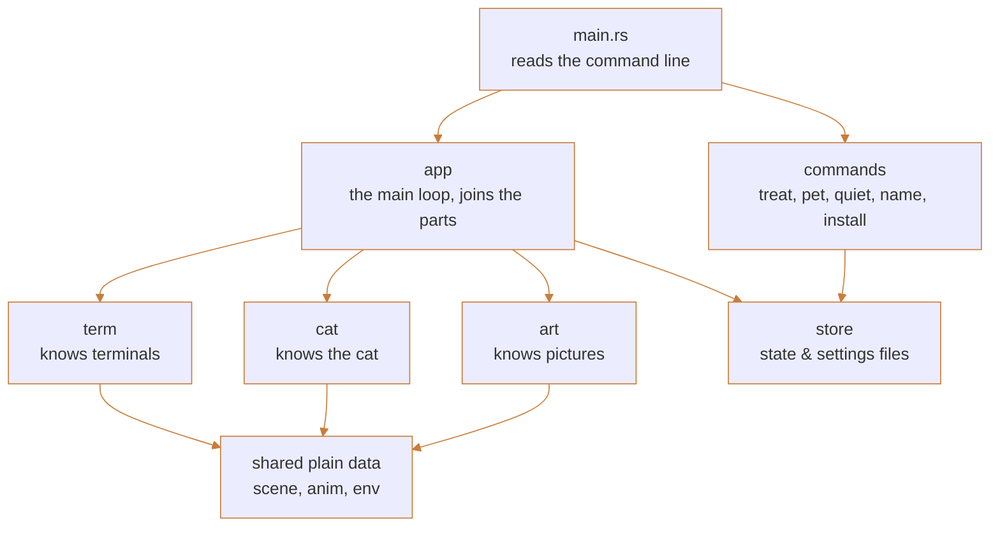
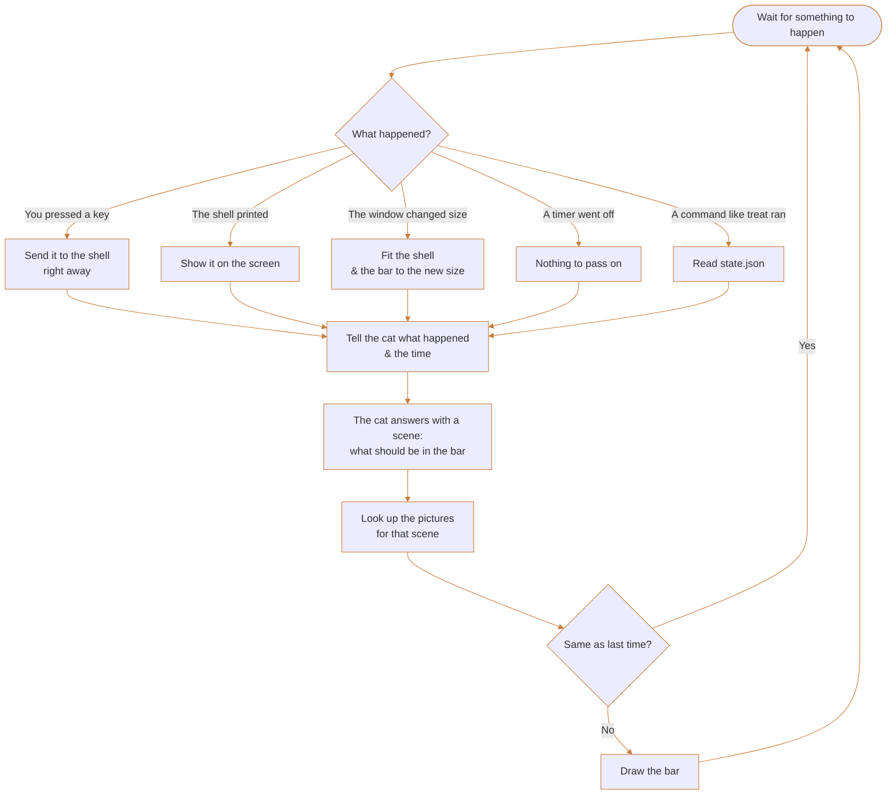
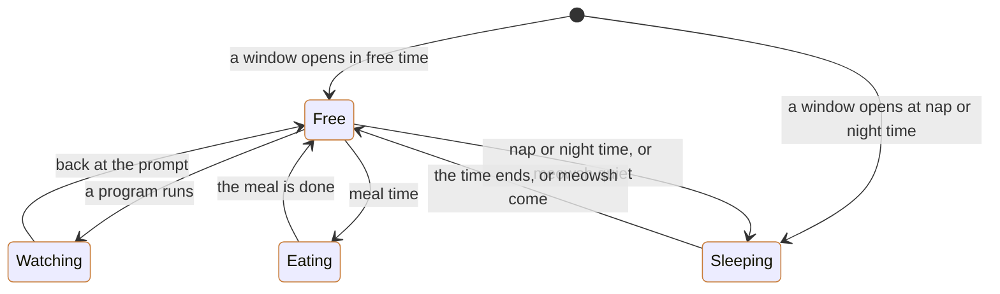
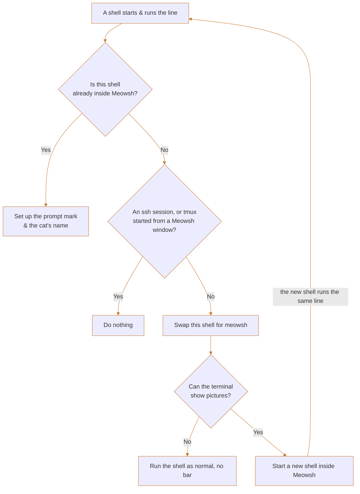

# Architecture

* How Meowsh works inside & what every source file does or will do.
* What the cat does: [DESIGN.md](DESIGN.md). How frames are made: [ANIMATION.md](ANIMATION.md). Order of work: [ROADMAP.md](ROADMAP.md).
* Built so far: the wrapper, the startup scripts & install. The bar, the cat & the art are still plans. See [ROADMAP.md](ROADMAP.md#status).

## Contents

* [Overview](#overview)
* [Key Terms](#key-terms)
* [The Big Picture](#the-big-picture)
* [The Three Parts](#the-three-parts)
* [The Main Loop](#the-main-loop)
* [The Terminal Part](#the-terminal-part)
* [The Cat Part](#the-cat-part)
* [The Art Part](#the-art-part)
* [What Is Shared](#what-is-shared)
* [How Commands Reach The Cat](#how-commands-reach-the-cat)
* [How Meowsh Starts](#how-meowsh-starts)
* [Where Data Is Stored](#where-data-is-stored)
* [Safety](#safety)
* [Hard Parts](#hard-parts)
* [File Reference](#file-reference)

## Overview

* Meowsh sits between your terminal window & your shell. Every key & every line of output passes through it.
* It tells the shell the window is a few rows shorter than it is & draws the cat in the rows left over.
* **Pass everything through.** Keys & output are forwarded as they are.
* **Keys first.** A key goes to the shell before the cat reacts.
* **Draw only on change.** If nothing in the bar changed, Meowsh draws nothing.
* **Parts that do not know each other.** The terminal code knows nothing about cats. The cat code knows nothing about terminals. Each can be changed & tested alone.
* **Art is data, not code.** A new animation is a folder of frames & a small settings file. Its speed needs no Rust change.

## Key Terms

| Term | Meaning |
| --- | --- |
| **Terminal** | The window program: kitty, or the terminal in VS Code. |
| **Shell** | The program that reads your commands: bash or zsh. |
| **PTY** | A stand in terminal. Meowsh makes one, runs your shell in it & sits between it & the real window. |
| **Bar** | The bottom rows, kept for the cat. |
| **Escape code** | A hidden instruction inside terminal output, such as "clear the screen" or "show this picture". |
| **Prompt mark** | A hidden code Meowsh's shell setup prints before each prompt. It says the last command finished & whether it failed. |
| **Notice** | Something the cat is told, such as "you typed" or "a command failed". |
| **Scene** | A plain list of what should be in the bar: which picture, where & facing which way. |
| **Painter** | The code that draws the scene's pictures into the bar. |

## The Big Picture



* No network. Windows share only the state file.

## The Three Parts



| Part | Knows About | Never Uses | Tested With |
| --- | --- | --- | --- |
| **term** | The PTY, escape codes, the bar rows, showing pictures. | `cat`, `art` | Recorded output & real PTYs in `tests/`. |
| **cat** | Modes, actions, reactions, the day, where the cat is. | `term`, `art`, the real clock | Plain unit tests. No terminal, no waiting. |
| **art** | Loading frames, coloring them, flipping them. | `term`, `cat` | Unit tests on small images. |
| **app** | All of the above. It is the only part that joins them. | nothing | Whole program tests in `tests/`. |

* The arrows only go one way. The compiler will not stop a wrong `use`, so reviews check this. See [CONTRIBUTING.md](../CONTRIBUTING.md#where-code-goes).

## The Main Loop

* One loop in `app/session.rs` runs the whole program. It waits for something to happen, deals with it, then waits again.
* Helper threads only listen: one for your keys, one for the shell's output, one for window resizes. They hand what they hear to the loop.



* When the shell exits, the loop cleans up & exits with the shell's own exit code.
* The timer runs slower when the cat is still, so a sleeping cat costs almost nothing.

## The Terminal Part

* Lives in `src/term/`.

### Keeping The Bar Rows

* Meowsh reads the window size. Say 40 rows.
* It starts the shell in a PTY with 38 rows.
* It tells the window that only rows 1 to 38 may scroll.
* It draws the cat in rows 39 & 40.
* Row 1 stays row 1, so nothing in the shell's output needs changing.

### Keeping The Bar Safe

| What Happens | The Damage | What Meowsh Does |
| --- | --- | --- |
| A program clears the screen | The cat is wiped. | Draws it again. |
| A program resets which rows scroll | The bar can scroll away. | Puts its own limit back. |
| A program moves the cursor into the bar | It would write over the cat. | Stops the cursor at the last shell row. |
| A full screen program such as `vim` opens or closes | The new screen has no bar. | Sets the bar up & draws again. |
| The window is resized | The rows move. | Resizes the shell, sets the bar up & draws again. |
| The window is too short | No room. | Turns the bar off until it grows. |

### The Painter

* Takes the list of pictures to show. Knows nothing about what they are.
* If the list is the same as last time, it does nothing.
* It waits for a pause in the shell's output, so it never cuts into it.
* It shows each new picture first, then removes the old one, so the cat never flickers.
* It puts the cursor back where the shell left it.
* It tells the terminal not to reply, because a reply would arrive as if you typed it.
* Each window only removes its own pictures.

### Knowing What Is Happening

| What | How Meowsh Knows |
| --- | --- |
| **Typing** | Any key from the keyboard. |
| **Back at the prompt** | The prompt mark. Stopping a command with Ctrl C does not count as failing. |
| **Program in front** | Meowsh asks the PTY which program is in front, then reads its name. `claude` & `codex` count as coding agents. |
| **Full screen** | Meowsh keeps its own copy of the screen, which says so. |

* `term` reports these as plain facts. `app` turns them into notices for the cat.

## The Cat Part

* Lives in `src/cat/`. It never touches the terminal, files, or the real clock.

```rust
// the shape of it, not final code
impl Cat {
    pub fn update(&mut self, time: Time, notices: &[Notice]) -> Scene;
}
```

* `Time` holds how long Meowsh has run & the time of day. Tests can make up any time.
* `Notice` is something like `Typed`, `ProgramStarted`, `BackAtPrompt { failed }`, `Treat`, `Pet`, `Quiet`, `Come`.
* `Scene` says what should be in the bar right now. See [What Is Shared](#what-is-shared).

### Modes



| File | Job |
| --- | --- |
| `cat.rs` | The `Cat` type. Picks the mode & hands work to the files below. |
| `cat/day.rs` | Turns the time of day into meal, nap, night, or free time. |
| `cat/action.rs` | Picks a resting action: sit, walk, play, run. Some come up more often than others. |
| `cat/reaction.rs` | Short reactions on top of a mode: look up, flinch, perk up, purr. |
| `cat/player.rs` | Plays one animation: which frame to show at a given time & whether it is done. |
| `cat/motion.rs` | Where the cat is in the bar & which way it faces. |

* Random choices start from a number tests can set, so a test gets the same choices every time.

## The Art Part

* Lives in `src/art/`. Gets the cat's pictures ready to show.

### Once, At Startup

* Ask the terminal for its text color.
* Load every frame.
* Change white to the text color, unless the animation turns that off. Make a left facing copy.
* Keep them all in memory, ready to send.
* After that, the app asks for a picture by animation name & frame number. Nothing is loaded twice.

### How Frames Get In

* When the program is built, `build.rs` reads every folder in `assets/animations/`.
* It checks the frames & `anim.toml`, then packs them into the program.
* A broken folder, such as a missing frame or a wrong size, stops the build with a clear message.
* See [ANIMATION.md](ANIMATION.md) for the folder layout & `anim.toml`.

## What Is Shared

* Three small files every part may use. They hold plain data & no logic.

| File | Holds |
| --- | --- |
| `anim.rs` | The list of animations made by `build.rs`: names, frame counts, speeds, steps. |
| `scene.rs` | What is in the bar: which animation & frame, or which prop, where & which way it faces. |
| `env.rs` | The names of the settings Meowsh reads from the environment. |

* Positions are in art pixels from the left end of the bar. The painter turns them into a spot on screen.

## How Commands Reach The Cat

* A command such as `meowsh treat` changes `state.json` & exits.
* Every open window checks a few times a second whether the file changed.
* When it has, the window reads it & tells the cat.
* `quiet` is saved as on or off.
* `treat` & `pet` save the time they were run. Each window reacts once to a newer time.

## How Meowsh Starts

* `meowsh install` adds one line to `~/.zshrc` or `~/.bashrc`:

```sh
command -v meowsh >/dev/null && eval "$(meowsh init zsh)"
```



* A shell knows it is inside Meowsh from `MEOWSH_TTY`, a setting that names Meowsh's PTY.
* To check for pictures, Meowsh sends a tiny test picture & waits up to half a second for an OK.
* `meowsh start` & `meowsh init` are hidden helpers. You never type them.

## Where Data Is Stored

* In the usual config & data folders for your system.

| What | File | Holds |
| --- | --- | --- |
| Settings | `config.toml` in the config folder | Schedule times, bar height, how often each action comes up. Every value has a default. |
| State | `state.json` in the data folder | The cat's name, quiet on or off & the time of the last treat & pet. |
| Image hint | `image-hint-shown` in the data folder | If it exists, the hint was already shown once. |

* The state file is written in full to a new file, then swapped in, so a crash cannot leave it half written.

### Test Settings

| Setting | Does |
| --- | --- |
| `MEOWSH_CLOCK=06:55` | Starts the clock at that time. |
| `MEOWSH_CLOCK_SPEED=60` | Runs the clock 60 times faster, so a whole day can be checked in minutes. |

## Safety

* **If it cannot start, you still get a shell.** Meowsh runs your shell as normal.
* **If it crashes, your terminal is put back.** It removes its pictures & prints one line.
* **It does not read your work.** Output is only used to follow the cursor, clears & the prompt mark. None of it is saved.
* **Codes it does not know pass through untouched.**
* **No network.**
* **It keeps the exit code.** Meowsh exits with the shell's own code.

## Hard Parts

| Problem | Plan |
| --- | --- |
| An escape code can arrive split in two pieces. | Hold back the first piece until the rest arrives. |
| VS Code cannot reuse a picture it was already sent. | Send the whole picture each time it changes. |
| Smooth movement needs steps smaller than one character. | Shift the picture inside a character cell. Test in VS Code early. |
| Big frames are slow to send. | Keep frames small. See [ANIMATION.md](ANIMATION.md#frame-rules). |
| Coding agents redraw the screen often. | Draw the bar again after any output that could have touched it. |
| Drawing while a program is mid redraw can tear the screen. | Wait for it to finish. |

## File Reference

```
meowsh/
├── Cargo.toml              the package & the program, both named meowsh
├── build.rs                reads assets/animations & packs the frames in
├── assets/
│   ├── art/                Blender files
│   └── animations/         one folder per animation: anim.toml & frames
├── src/
│   ├── main.rs             reads the command line & runs the matching command
│   ├── lib.rs              the parts shared by the program & the tests
│   ├── anim.rs             shared: the animation list made by build.rs
│   ├── scene.rs            shared: what is in the bar & where
│   ├── env.rs              shared: names of environment settings
│   ├── app.rs              joins the parts, starts the session or falls back
│   ├── app/                the session & main loop, the helper threads, notices & the clock
│   ├── term.rs             the terminal part
│   ├── term/               PTY, raw mode, escape codes, keeping the bar, the painter, pictures, what is in front
│   ├── cat.rs              the cat part: the brain
│   ├── cat/                day, actions, reactions, player, motion
│   ├── art.rs              the art part: the pictures
│   ├── art/                pixels & color
│   ├── store/              state.json & config.toml
│   ├── commands/           one file per command
│   ├── shell.rs            the startup scripts that meowsh init prints
│   └── shell/              the bash & zsh scripts
└── tests/                  whole program tests with real PTYs
```

### Libraries

| Crate | Used For |
| --- | --- |
| `portable-pty` | The PTY & the shell inside it. |
| `vt100` | Meowsh's own copy of the screen. |
| `vte` | Reading escape codes in the shell's output. |
| `crossterm` | The size of the real window & switching keys to pass straight through. |
| `signal-hook` | Noticing when the window is resized. |
| `png` | Loading frames. |
| `base64` | Packing pictures to send. |
| `clap` | Reading the command line. |
| `serde`, `serde_json`, `toml` | The state & settings files & `anim.toml`. |
| `directories` | Finding the config & data folders. |
| `jiff` | The time of day. |
| `fastrand` | Random choices that tests can repeat. |
| `libc` | Asking which program is in front. |
| `anyhow` | Errors. |
