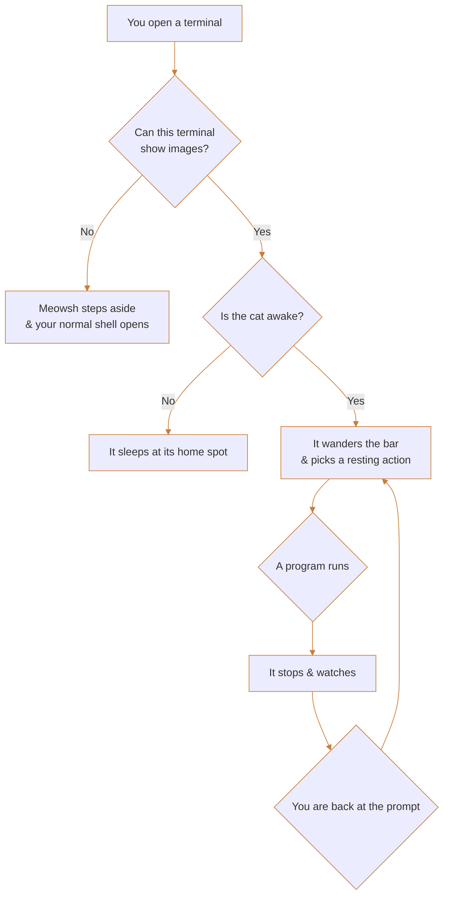

# Design

* What Meowsh is & how the cat behaves.
* How it is built: [ARCHITECTURE.md](ARCHITECTURE.md). How the cat is drawn: [ANIMATION.md](ANIMATION.md).
* This describes the planned behavior. Only the shell wrapper & install are built so far. See [ROADMAP.md](ROADMAP.md#status).

## Contents

* [Overview](#overview)
* [Key Terms](#key-terms)
* [The Screen](#the-screen)
* [In The Bar](#in-the-bar)
* [The Cat's Day](#the-cats-day)
* [At Rest](#at-rest)
* [What It Notices](#what-it-notices)
* [The Cat's Look](#the-cats-look)
* [Commands](#commands)
* [Naming The Cat](#naming-the-cat)
* [Install & Remove](#install--remove)
* [Supported Terminals](#supported-terminals)
* [tmux & ssh](#tmux--ssh)
* [Rules That Do Not Change](#rules-that-do-not-change)
* [Left For Later](#left-for-later)

## Overview

* Meowsh is a small cat that lives in your terminal.
* It lives in its own space at the bottom of the screen & never leaves it. It sleeps, wanders & plays there.
* It notices what you do: it looks up when you type, watches while programs run & flinches when a command fails.
* It keeps its own day by the clock: it eats, naps & sleeps at set times.
* You can give it a treat, pet it & name it.

* **The terminal comes first.** The cat never slows typing or covers your work.
* **Simple to live with.** Nothing to earn, nothing to keep up with. It is your cat from the first day.
* **Easy to quiet.** One command puts the cat to sleep.

## Key Terms

| Term | Meaning |
| --- | --- |
| **Bar** | The bottom rows of the terminal. They belong to the cat. |
| **Home spot** | The left end of the bar, where the cat sleeps & keeps its bowl. |
| **Prompt** | The line where your shell waits for a command. |
| **Idle** | The shell is waiting at the prompt & nothing has been typed or printed for a while. |
| **Schedule** | The times of day the cat eats, naps & sleeps. |
| **Frame** | One small picture of the cat. |
| **Animation** | A set of frames played in order, such as the walk. |
| **Prop** | Something in the bar that is not the cat, such as the bowl or the ball. |
| **Image check** | Meowsh asking the terminal at launch whether it can show images. |

## The Screen

```
+----------------------------------------------------+
| ~/code > cargo build                               |
|    Compiling meowsh v0.1.0                         |
|     Finished in 4.2s                               |   your shell &
| ~/code > _                                         |   your programs
|                                                    |
+----------------------------------------------------+
|                                            /\_/\   |   the bar: rows
|                                           ( o.o )  |   for the cat
+----------------------------------------------------+
```

* The cat is shown as text here. The real cat is a small image.
* The bar has no line or border. It is empty rows with the cat in them, so the window looks like a normal terminal.
* Programs never draw in the bar. They do not know it exists.
* In a window too short to share, the bar turns off.

## In The Bar



* The cat never leaves the bar. It never walks over your text or sits where you type.
* It can go anywhere along the bar & it faces the way it walks.

## The Cat's Day

* The cat follows the clock on your computer. Every day is the same.

| Time | What The Cat Does |
| --- | --- |
| 7 to 9 am | **Breakfast.** It eats from its bowl. |
| 1 to 3 pm | **Nap.** It sleeps at its home spot. |
| 6 to 7 pm | **Dinner.** It eats from its bowl. |
| 11 pm to 7 am | **Night.** It sleeps at its home spot. |
| Any other time | **Free time.** It wanders the bar & picks a resting action. |

* A meal lasts a few minutes, from the start of meal time or from when you open a window during it.
* At meal & sleep times, the cat walks to its home spot first.
* A sleeping cat stays asleep when you type.
* The times live in the settings file, with these as the defaults.

## At Rest

* In free time, the cat picks an action, does it for a while, then picks again.

| Action | What You See | How Often |
| --- | --- | --- |
| **Sit** | Still, with a blink or a tail flick. | Most of the time |
| **Walk** | A stroll to a new spot in the bar. | Sometimes |
| **Play** | Bats at its ball, or pounces. | Sometimes |
| **Run** | A dash from one end of the bar to the other. | Rarely |

* Later ideas: chase its tail, lick its paw, roll on its back.

## What It Notices

* Every reaction happens inside the bar. A sleeping cat does not react.

| What Is Happening | What The Cat Does |
| --- | --- |
| You type at the prompt | Looks up for a moment. |
| A program is running | Sits & watches. |
| A program has run for a long time | Naps until you are back at the prompt. |
| A coding agent such as Claude Code is running | Perks up. |
| A command fails | Flinches. Not when you stopped it with Ctrl C. |
| A full screen program such as `vim` is open | Sits still. |

## The Cat's Look

* A round, simple white cat with big dot eyes, like the [reference sheet](assets/cat-reference.png), redrawn fresh in Blender. See [ANIMATION.md](ANIMATION.md) for how it is made.
* These rules hold whatever it looks like:

* It is one image per frame, with a see through background.
* It fits the bar, scaled to your font size.
* It is drawn facing right. Meowsh flips it to face left.
* Every animation uses the same cat, the same size & the same floor line.
* It is drawn white with black eyes. Meowsh recolors it to your terminal's text & background colors, so it looks the same on a dark theme & turns dark with light eyes on a light one.
* Each frame is 309 by 215 pixels, with the feet on row 204, shown in a three row bar.
* Drawn & posed in Blender with Grease Pencil.

| Animation | Used For |
| --- | --- |
| Sleep | Naps & night. |
| Wake | Waking up. |
| Sit | Resting & watching. |
| Sit down & stand up | Moving between walking & sitting. |
| Walk | The walk action & going home. |
| Run | The run action & chasing the ball. |
| Turn | Turning around. |
| Eat | Meals & treats. |
| Play | Crouch, pounce & bat the ball. |
| Reactions | Look up, flinch, perk up & being petted. |

| Prop | Used For |
| --- | --- |
| Bowl | Meals & treats, at the home spot. |
| Ball | Play. It stays where it last rolled. |

## Commands

| Command | Does |
| --- | --- |
| `meowsh treat` | Gives the cat a treat. It eats it, even if it was asleep, then goes back to what it was doing. |
| `meowsh pet` | Pets the cat. It purrs. A sleeping cat purrs in its sleep. |
| `meowsh name <name>` | Names the cat. See [Naming The Cat](#naming-the-cat). |
| `meowsh quiet` | The cat sleeps & nothing moves. |
| `meowsh come` | Wakes the cat. Ends `quiet`. |
| `meowsh install` | Adds Meowsh to your shell. |
| `meowsh uninstall` | Removes Meowsh from your shell. |

* There is one cat, so a command applies in every window.

## Naming The Cat

* `meowsh name mochi` names the cat Mochi.
* In windows you open after that, `mochi` works in place of `meowsh`. For example, `mochi treat`.
* `meowsh` always keeps working.
* The name must be one word: letters, numbers & dashes.
* If you already have a command with that name, Meowsh says so & does not add it.

## Install & Remove

* Get the program:

```sh
cargo install meowsh
```

* Add it to your shell:

```sh
meowsh install
```

* Open a new terminal.

* `meowsh install` adds one line to the startup file of bash or zsh.
* In VS Code, also turn on `terminal.integrated.enableImages`.

## Supported Terminals

* Meowsh runs on macOS & Linux.
* At launch, Meowsh asks the terminal whether it can show images. If not, it steps aside & your normal shell opens.
* There is no text version of the cat.

| Terminal | Status |
| --- | --- |
| kitty | Main target. Tested in every phase. |
| VS Code terminal | Tested in every phase. Needs `terminal.integrated.enableImages` on. |
| iTerm2, Ghostty, WezTerm | Should work. Untested. |
| Terminals that cannot show images, such as the macOS Terminal app | Not supported. |

* The first time a terminal says no, Meowsh prints one line that says why. After that it stays silent.

## tmux & ssh

* There is one cat & it lives on your own machine. tmux & ssh never add a second cat to the same screen.

| Where You Are | What Happens |
| --- | --- |
| tmux started from a Meowsh window | tmux is a program like any other. The cat stays in the window's bar. |
| tmux started on its own | Later. For now Meowsh steps aside. |
| ssh from a Meowsh window | ssh is a program like any other. The cat watches from your bar. |
| A shell on the far machine | If Meowsh is installed there too, it steps aside. |

## Rules That Do Not Change

* **The terminal comes first.** Every key reaches your shell before the cat reacts.
* **The cat never covers your work.** It never leaves the bar.
* **A broken Meowsh never locks you out.** If it cannot start, your normal shell opens. If it crashes later, your terminal is put back the way it was.
* **Easy to quiet, easy to remove.** One command each.
* **Nothing leaves your machine.** No network & no account.
* **One cat.** Every window shows the same cat on the same schedule.

## Left For Later

* tmux started on its own, with a cat in each pane.
* The mouse scaring the cat.
* Done notifications when a long command finishes while you are away.
* A different schedule on weekends.
* Other shells, such as fish.
