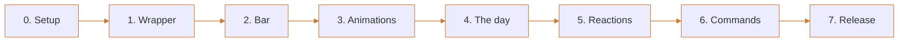
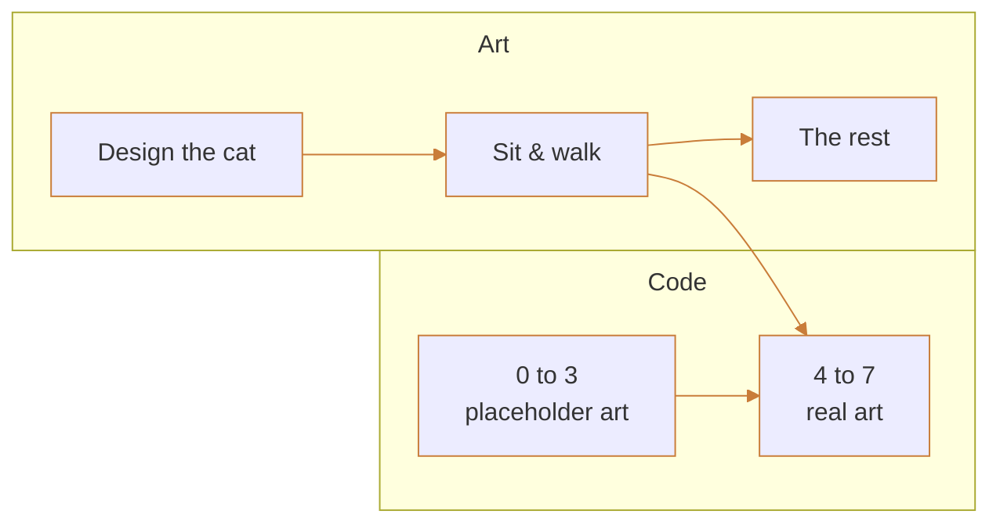

# Roadmap

* The order Meowsh gets built in.
* A phase is complete only when its **Done when** line is true in kitty & in the VS Code terminal, on macOS.
* Last updated November 24, 2026.

## Contents

* [Status](#status)
* [Versions](#versions)
* [Two Tracks](#two-tracks)
* [Phases](#phases)
* [Art Track](#art-track)
* [Later Ideas](#later-ideas)

## Status

| Phase | Goal | Status |
| --- | --- | --- |
| 0 | An empty project with the rules & checks in place | Done |
| 1 | A wrapper you cannot notice | Done |
| 2 | The bar, with one still picture in it | Done |
| 3 | Animations from folders & a preview command | Done |
| 4 | The cat's day & resting actions | In progress |
| 5 | Reactions | Planned |
| 6 | Commands: treat, pet, quiet, come, name | Planned |
| 7 | A public release | Planned |

## Versions

* **v0.1** after Phase 4, with `sit`, `walk` & `sleep`. Meals & play use `sit` until their art is drawn. Published to crates.io, with a short README.
* **v0.2** after Phase 5, with the reactions & their art.
* **v0.3** after Phase 6, with the commands, `eat` & the bowl.
* **v1.0** when `sit`, `walk`, `sleep`, `wake`, `sit_down`, `eat`, the bowl, `look_up`, `flinch` & `perk_up` are drawn & Meowsh is tested on Linux.
* `run`, `turn`, play & `purr` come after v1.0.

## Two Tracks

* Code & art can move at the same time.
* Phases 0 to 3 need no real cat. A plain placeholder shape is enough.
* The art track can start today & take as long as it needs. Phase 4 is where the code starts to need real animations.

## Phases

### Phase 0: Setup

* `cargo new meowsh`. The package & the program share the name.
* Clippy rules in `Cargo.toml`: deny `unwrap_used` & `expect_used`.
* CI that runs fmt, clippy & tests on macOS & Linux.
* Empty files for `term`, `cat`, `art`, `app`, with their `//!` lines.

* **Done when:** CI passes on an empty program.

### Phase 1: The Wrapper

* `meowsh start` runs your shell inside Meowsh & passes every key & all output through.
* Login shells, resizes & the shell's exit code work.
* If it cannot start, it runs your shell directly. After a crash, the terminal is put back.
* `meowsh init` & the mark that tells a shell it is already inside Meowsh. ssh & tmux started from Meowsh step aside.
* `meowsh install` & `meowsh uninstall`.

* **Done when:** `vim`, Claude Code, tmux, ssh, colors, Ctrl C & resizing behave the same inside Meowsh as outside.

### Phase 2: The Bar

* The check for image support & the one time hint when it is missing.
* Keeping the bottom rows for the bar & keeping programs out of them.
* The painter: draws pictures in the bar, only when something changed, with no flicker.
* One still placeholder picture in the bar.

* **Done when:** the picture stays put through `clear`, `vim`, Claude Code, resizes & long output.

### Phase 3: Animations

* `canvas.toml` & the `anim.toml` format from [ANIMATION.md](ANIMATION.md).
* The build reads `assets/animations/`, checks the frame rules & packs the frames into the program.
* At startup, Meowsh loads the frames, sets their color & makes left facing copies.
* `cat/player.rs` plays one animation by its timing.
* `meowsh preview <name>` plays one animation in the bar, for checking art.

* **Done when:** a placeholder animation plays & walks across the bar smoothly & changing `frame_ms` changes its speed with no Rust change.
* Done with the real `sit`. Walking across the bar moves to Phase 4, because only `sit` is drawn so far.

### Phase 4: The Day

* `cat/day.rs`: meal, nap, night & free time, with `MEOWSH_CLOCK` & `MEOWSH_CLOCK_SPEED`.
* Modes: free, watching, eating, sleeping.
* Resting actions: sit, walk, play, run.
* Going home for meals & sleep.

* **Done when:** a whole day plays out with `MEOWSH_CLOCK_SPEED=60`, using real art, & the cat walks across the bar smoothly.

### Phase 5: Reactions

* Look up when you type.
* Watch while a program runs & nap on a long run.
* Perk up for a coding agent.
* Flinch when a command fails, but not on Ctrl C.

* **Done when:** each reaction plays at the right moment & a sleeping cat ignores them.

### Phase 6: Commands

* `state.json` & how wrappers notice it changed.
* `meowsh treat`, `meowsh pet`, `meowsh quiet`, `meowsh come`.
* `meowsh name` & the name working as a command in new windows.

* **Done when:** a command run in one window shows in every open window.

### Phase 7: Release

* A README with a short video of the cat.
* `cargo install meowsh` works from crates.io.
* Tested on Linux as well as macOS.

## Art Track

* Set up Blender. See [ANIMATION.md](ANIMATION.md#blender-setup).
* Design the cat & its bones, in white, on the 309 by 215 canvas: round & simple with big dot eyes, like [the reference sheet](assets/cat-reference.png).
* Draw `sit` & `walk` first. They are enough to start Phase 4.
* Then `sleep`, `wake`, `eat` & the bowl.
* Then play, run, turn & the reactions.

## Later Ideas

* Chase its tail, lick its paw, roll on its back.
* tmux started on its own, with a cat in each pane.
* Done notifications.
* The mouse scaring the cat.
